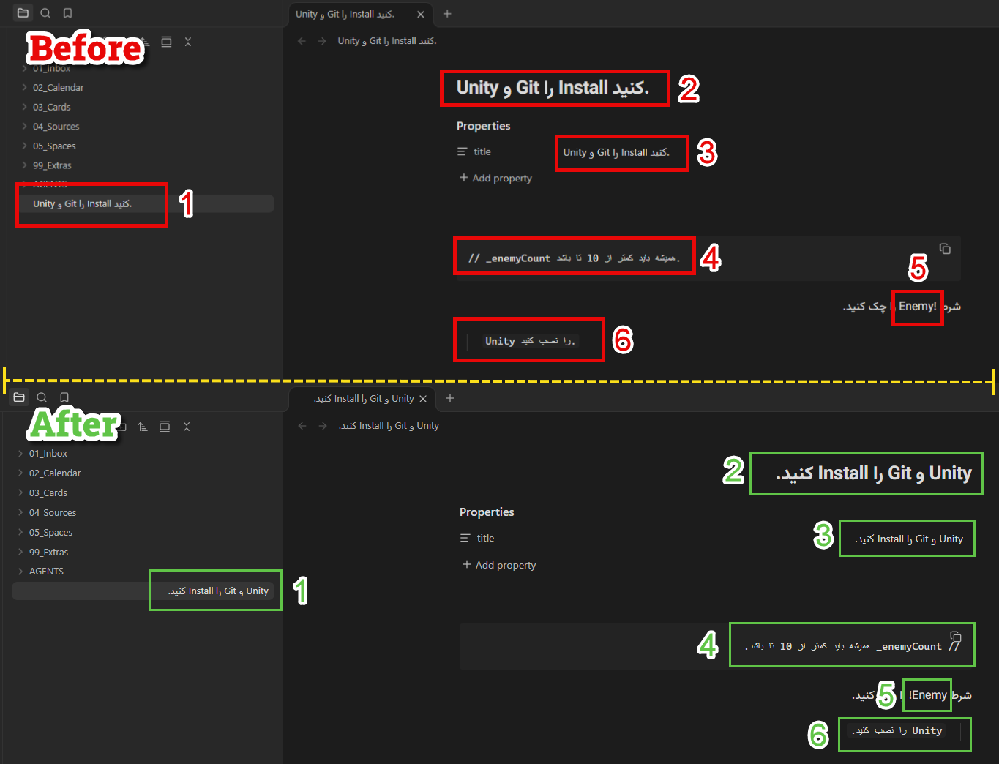

# Obsidian Persian RTL & Smart Direction

This plugin automatically detects Persian/Arabic content and adjusts the text direction (RTL) for paragraphs, headings, properties, and list items. It ensures your mixed-language documents look professional without adding hidden characters.

---
## Features

- **Smart Detection:** Automatically applies RTL if any Persian/Arabic character is present.
- **Context-Aware:** Preserves LTR for code, URLs, and specific symbols (e.g., `$`, `!`, `^`).
- **Full Support:** Works in Reading View, Live Preview, and Source Mode.
- **Code Comments:** Properly handles RTL in code comments while keeping syntax intact.
- **English Phrases:** Keeps consecutive English words in one LTR span within Persian sentences.
- **Tables:** Detects each cell independently in Reading View and Live Preview, including English words at the end of Persian text.
- **Non-destructive:** Does not modify your underlying Markdown files or metadata.
- **Lightweight:** No external dependencies or network required.

---
## Examples

The plugin handles mixed-language content seamlessly:

Unity و Git را Install کنید.

// _enemyCount همیشه باید کمتر از 10 تا باشد.

شرط !Enemy را چک کنید.

    Unity را نصب کنید.

---
## Installation

Install this plugin directly via the **Obsidian Community Plugins** browser:
1. Open **Settings** > **Community plugins**.
2. Click **Browse** and search for "Persian RTL Smart Direction".
3. Install and Enable.

---
## How it works

The plugin scans blocks for Persian/Arabic characters. If found, it forces an RTL layout. It treats list items individually and respects explicitly defined HTML directions. 

Use the **"Refresh Persian text direction"** command from the Command Palette if you need to force an immediate update.

## Development checks

This plugin ships directly as `main.js`, `styles.css`, and `manifest.json`; no build step is required.

Run the text direction regression checks with `node --test tests/direction.test.cjs`.
With the local plugin installed and enabled in an open vault, run `node tests/run-obsidian.cjs "Vault name"` to check DOM layout and CodeMirror letter order. These checks use disposable offscreen elements, preserve note contents and focus, and take no screenshots.
